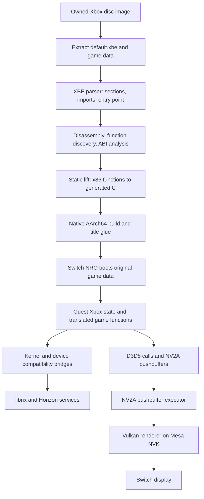

# Technical guide for future ports

This guide explains how this project turns an original Xbox title into a Nintendo Switch homebrew app. It
separates shared toolkit work from per-title integration and Switch-specific work so a future port can reuse
the right layer. The concrete examples are Conker: Live & Reloaded and this repository's vendored
`xboxrecomp/` fork.

## Architecture at a glance

The game logic is statically translated before runtime. The NRO does not interpret Xbox instructions or run
an Xbox operating system. It links the generated C with a compatibility runtime that supplies the Xbox
kernel, memory, file, input, audio, and graphics behavior the title expects.

## Three layers to keep distinct

| Layer | Shared across titles | Per-title work |
|---|---|---|
| Recompiler toolkit | XBE parsing, x86 disassembly and lifting, guest register model, runtime libraries | Seed entries the detector missed; report and fix lifter bugs with small reproducible examples |
| Xbox title integration | Kernel and D3D8 APIs, dispatch, filesystem and device abstractions | Game paths, image layout, stack location, selected native hooks, device-specific function addresses |
| Switch host | libnx startup, SDL window/audio/input, Horizon memory and thread services, NVK | Choose renderer/build settings, validate memory limits and timings on actual hardware |

Before changing code, classify the failure into one of these layers. A title-specific address should usually
live in title configuration or a documented hook. A behavior that is common to Xbox titles belongs in the
toolkit. A Horizon constraint belongs in the Switch platform implementation.

## The translation pipeline

1. **Extract the XBE and files.** Keep the unpacked game tree intact. The runtime opens files from SD storage;
   it does not mount the ISO. Keep proprietary game data and generated lifted code out of source control.
2. **Parse the XBE.** `tools.xbe_parser` reads the XBE header, image sections, imports, entry point, and kernel
   thunk table. Save its analysis JSON beside the XBE; later tools use that exact section map.
3. **Discover functions.** `tools.disasm` decodes executable sections and records functions, references,
   strings, and candidate call targets. XDK libraries can contain executable code outside `.text`; specify
   relevant extra sections rather than assuming `.text` is the whole program.
4. **Identify functions and calling conventions.** `tools.func_id` recognizes common CRT/XDK/library code.
   `tools.abi_analysis` estimates calling convention and argument count. Review unusual entries, callbacks,
   vtables, tail jumps, and functions with hand-written assembly.
5. **Lift to C.** `tools.recomp` translates each discovered x86 function into C and emits a dispatch table.
   Generated code retains guest addresses and an explicit guest register/FPU model. Generated chunks are
   build artifacts, not hand-edited source.
6. **Build the native app.** Compile generated C together with the port's main entry, manual overrides, and
   the runtime. The same lifted code can be built for a desktop diagnostic target and for AArch64 Switch.
7. **Run and feed evidence back.** Resolve missing indirect calls, incorrect ABI assumptions, unsupported
   instructions, and host API mismatches. Add only verified function entries to the seed list, then rerun
   the pipeline.

For this repository, `tools/regen.sh` runs steps 2–5. A full run is required after changing function seeds;
`LIFT_ONLY=1` is for changes that do not alter function discovery or ABI analysis. `config/seed_functions.json`
is deliberately hand-reviewed: a seed in the middle of a real function truncates that function and can make
the failure much harder to diagnose.

## Runtime components

### Boot and guest CPU state

`src/main.c` selects the XBE and its data root, allocates/maps guest memory, initializes the compatibility
libraries, and transfers control to the XBE entry point. `recomp_dispatch.c` maps Xbox virtual addresses to
generated C functions. `src/recomp_manual.c` provides hand-written replacements or wrappers where the generic
lift is unsuitable, such as timing-sensitive XDK routines or known native hot paths.

The guest register model matters: translated functions exchange Xbox registers through runtime state and
carry guest EFLAGS and x87 state as required. Do not replace a missing guest function with a host C function
until its calling convention, register inputs/outputs, stack cleanup, and return value are understood.

### Memory and address translation

An original Xbox title expects 64 MB of RAM visible through more than one address range: ordinary low
addresses, a contiguous window, and the tiled framebuffer aperture. Desktop operating systems can create
aliased views. Horizon's memory services have stricter mapping rules, so the Switch runtime uses code-memory
views where possible and folds some guest address ranges in translated pointer/MMIO accesses.

Porting checks:

- Read the XBE image end and choose a guest stack/runtime-data base that does not overlap `.data` or BSS. In
  this Conker build the image reaches about `0x00891D20`, so the stack base is set to `0x00900000`.
- Treat every guest pointer passed to an OS IPC or filesystem service as suspect. Copy through host-owned
  buffers where the service cannot safely access guest mappings.
- Trace failures at the exact guest VA and distinguish an unmapped page from an invalid alias, an ordinary
  allocation, or a framebuffer/device aperture access.
- Reproduce missing-mirror behavior in the desktop build with `RECOMP_NO_MIRRORS=1`; still validate the
  final mapping behavior on hardware.

### Kernel, filesystem, and synchronization

The kernel bridge translates Xbox imports into host implementations: memory allocation, file access,
threads, events, semaphores, timers, and device operations. Xbox paths such as `\Device\CdRom0\` and `Z:\`
are mapped to the extracted game directory and persistent save/cache directories. Preserve Xbox create/open
dispositions and status codes; a host `ENOENT` can mean either a genuine missing asset or a failed attempt
to create a nested cache directory.

Horizon threads are cooperative at most priorities. Keep guest CPU work on application cores and explicitly
yield long guest polling loops. Give audio and other host service threads priorities that let them meet their
deadlines without starving game threads. Never treat a tight Xbox spin loop as harmless on the Switch.

### Graphics

The title calls its original D3D8/XDK interfaces. Those calls write NV2A state and pushbuffers into guest
memory. The runtime parses the command stream, tracks NV2A state, and translates draws into host graphics
work. On the Switch build, that path ends in Vulkan through Mesa NVK. D3D resource management and NV2A
execution are separate pieces: a correct draw command can still render incorrectly if the resource format,
swizzle, surface alias, shader state, or framebuffer address is wrong.

Debug in this order: capture the frame or pushbuffer; identify the first incorrect surface/state; check the
guest framebuffer address and tiling; then inspect the translated shader or Vulkan resource usage. Use
`RECOMP_GL_DUMP` for supported frame captures and the targeted NV2A surface dump switches documented in
`docs/07-debugging.md`. Desktop Vulkan/lavapipe output is useful for correctness; it is not a performance
measurement for NVK.

### Audio, input, and video

The runtime maps Xbox controller state to XInput and then to SDL/libnx controller input. DirectSound buffers
and the Xbox MCPX APU have separate compatibility paths; a game can initialize one and still rely on work
from the other. Trace buffer creation, voice state, and mixer cadence separately from the video frame loop.
Movie decoding may use a native decoder when one is available, but keep that optional and license-compatible.

## Per-title integration checklist

- Record title region, XBE hash, section table, entry point, kernel imports, image end, and data directory.
- Confirm the toolchain covers every executable XBE section, including code in XDK library sections.
- Generate the ABI database before lifting; review entry points that use callbacks, vtables, unusual stack
  cleanup, or compiler-generated jump tables.
- Set stack/runtime-data addresses after checking the actual image and BSS range.
- Implement only the title-specific device hooks with evidence from disassembly and runtime state. Record
  each address, calling convention, register/stack contract, and source of evidence in the bring-up log.
- Run once with unresolved-call logging enabled. Verify each unresolved target against the XBE bytes and
  surrounding function boundaries before adding a seed.
- Trace the first boot failure through both the guest stack and the relevant host service (file, memory,
  graphics, audio, or scheduler). Log the observed symptom, cause, fix, and the build that verified it.
- Build and boot in a desktop/container target first. Use title takeover on the Switch for final validation;
  applet mode does not provide enough memory for these games.
- Measure performance only on the Switch at recorded stock clocks. Change one scheduling, rendering, or
  memory setting per run.

## Build and test loop in this project

The local container named `conker-dev` is useful for fast Linux Vulkan/lavapipe correctness runs. It supports
fresh save/cache directories, watchdog stack reports, FPS logging, and frame dumps. A clean desktop run can
show that the translated guest progressed and rendered; it cannot prove Horizon memory mappings or NVK
performance.

The Switch NRO is built with `VULKAN=1 STAGE_GAME=0 bash switch/build.sh`. The script stages the NRO under
`switch_sd/switch/conker/`; game assets stay on the SD card. `tools/nxlink_run.sh <switch-ip>` uploads and
starts it through Homebrew Menu's NetLoader, while capturing the runtime log under `run/net_logs/`. Start
Homebrew Menu with title takeover (hold R while launching a game), then open NetLoader with Y.

Keep each run's log and frame captures. Add durable findings to `docs/09-bringup-log.md`; put repeatable
debug controls in `docs/07-debugging.md`; put architectural knowledge useful to other titles here.

## Useful references in this repository

- [Approach and pipeline](02-approach.md)
- [Switch platform constraints](04-switch-platform.md)
- [Renderer architecture and gaps](05-renderer.md)
- [Debug switches](07-debugging.md)
- [Build commands](10-building.md)
- [Console test loop](11-testing-on-console.md)
- [Bring-up evidence and fixes](09-bringup-log.md)
